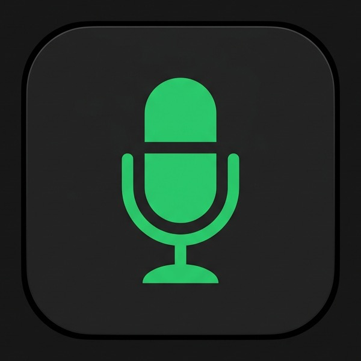
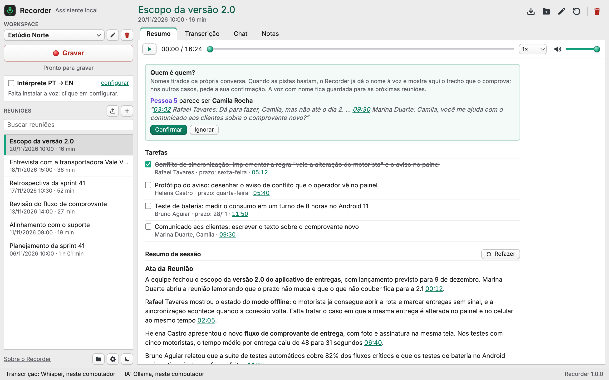
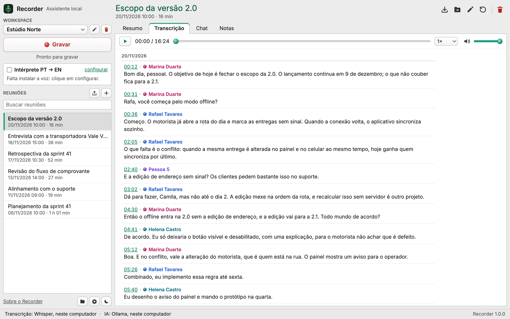
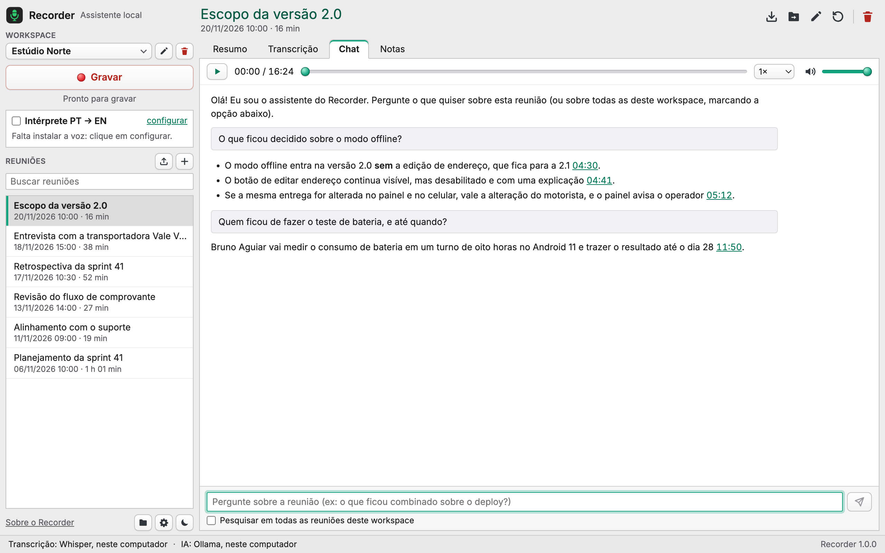
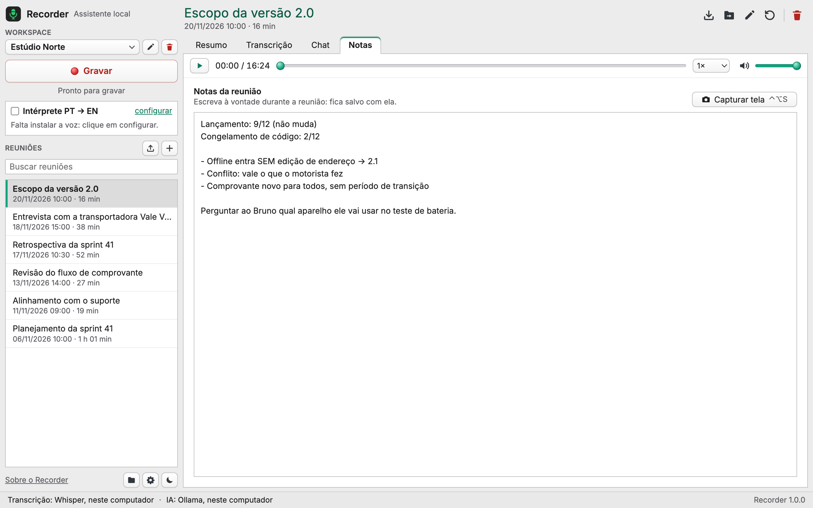
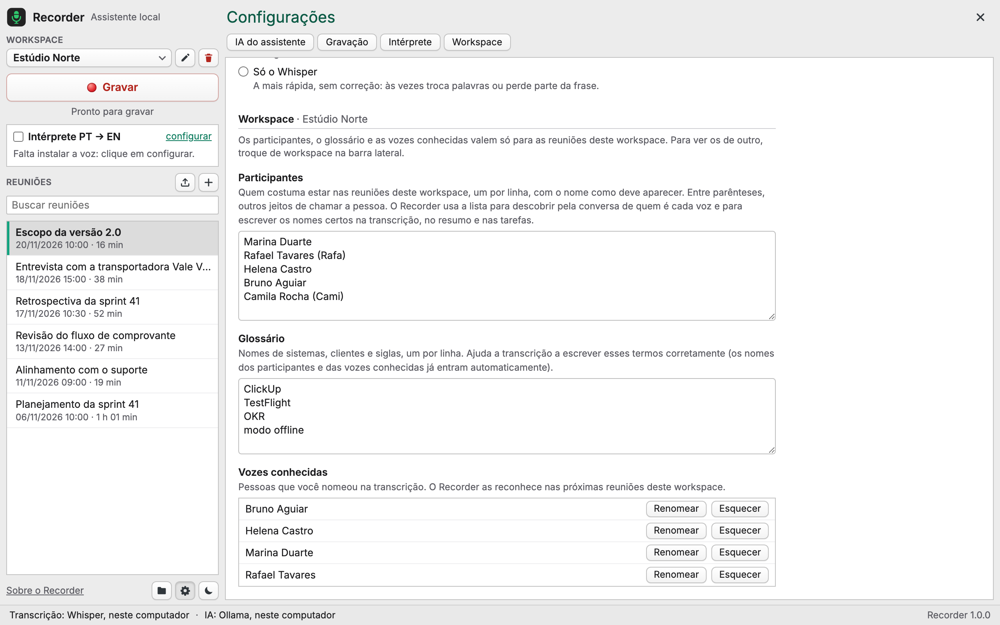
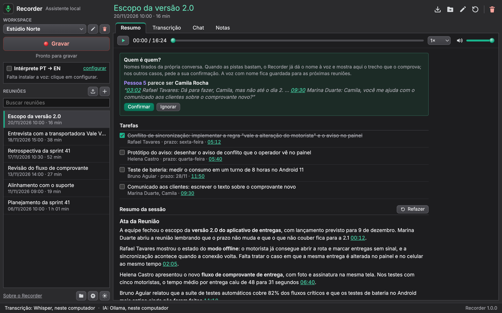
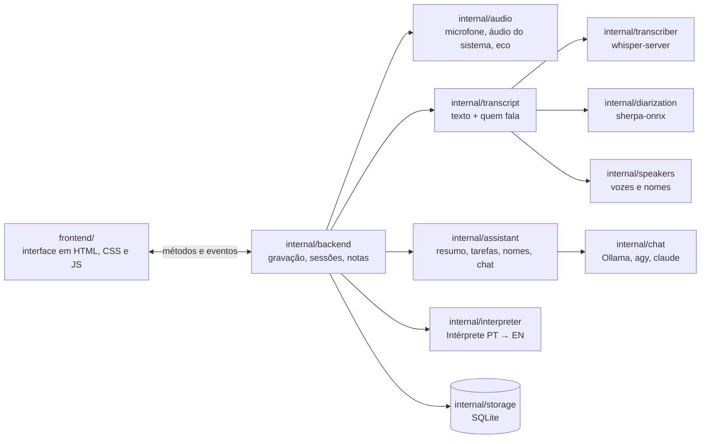

<p align="center">
  
</p>

<h1 align="center">Recorder</h1>

<p align="center">
  Grava, transcreve e resume as suas reuniões no próprio computador:<br>
  quem falou o quê, as tarefas combinadas e um chat que responde com base no que foi dito.
</p>

<p align="center">
  por <a href="https://diogoagra.dev">Diogo Agra</a>
</p>

<p align="center">
  
  
  
  
</p>

> **In English:** Recorder is a local-first meeting assistant for macOS and
> Windows. It records the microphone and the system audio, transcribes with
> whisper.cpp, tells speakers apart, and writes summaries, action items and
> chat answers with a local model (Ollama) or, if you choose so, with cloud
> models through the `agy` and `claude` command-line tools. It also has an
> interpreter that speaks English in your own voice while you talk in
> Portuguese. The app and its documentation are in Brazilian Portuguese.

<p align="center">
  
</p>

## Índice

- [Recursos](#recursos)
- [O que sai do seu computador](#o-que-sai-do-seu-computador)
- [Estado do projeto](#estado-do-projeto)
- [Compilar e rodar](#compilar-e-rodar)
  - [Requisitos](#requisitos)
  - [macOS](#macos)
  - [Windows](#windows)
  - [Alvos do Makefile](#alvos-do-makefile)
- [Desenvolvimento](#desenvolvimento)
- [Arquitetura](#arquitetura)
- [Documentação](#documentação)
- [Licença e créditos](#licença-e-créditos)

## Recursos

**Gravação e transcrição**

- Grava o **microfone e o áudio do computador** ao mesmo tempo (a reunião, um
  vídeo, o que estiver tocando), sem instalar driver de áudio.
- **Transcrição local** com o [Whisper](https://github.com/ggml-org/whisper.cpp),
  acelerada pela GPU no Mac, em blocos de 30 segundos e com o idioma detectado
  a cada bloco: reuniões que misturam português e inglês saem certas.
- **Cancelamento de eco** para quem ouve a reunião pelos alto-falantes.
- Se a transcrição cair no meio da reunião, o áudio continua sendo gravado e
  os blocos esperam; fechando o app, o trabalho é retomado na próxima abertura.
- **Importa áudio** gravado em outro lugar (m4a do iPhone, mp3, wav, áudios do
  WhatsApp, vídeos mp4/mov…) e o trata como uma reunião gravada no app.

**Quem está falando**

- Separa as vozes e marca cada fala (Pessoa 1, Pessoa 2…), sem enviar áudio
  para fora ([sherpa-onnx](https://github.com/k2-fsa/sherpa-onnx)).
- Dê nome a uma voz uma vez e o Recorder **reconhece a pessoa nas próximas
  reuniões**.
- **Nomes tirados da conversa**: "Ana, e você?", "como o João falou". Com pistas
  suficientes a voz já recebe o nome, com o trecho que comprova; com menos,
  vira uma sugestão para você confirmar.
- Lista de participantes e glossário por workspace, para os nomes e os termos
  saírem escritos do jeito certo.

**Resumo, tarefas e chat**

- **Resumo** ao parar a gravação, escrito ao vivo, com o momento do áudio de
  cada ponto: clicar em `12:34` toca o que se falava ali, no player da
  reunião (com velocidade de 0,75× a 2×).
- **Tarefas** com responsável, prazo e momento, e uma caixa para marcar as
  feitas.
- **Chat** que responde só com o que foi dito, na reunião aberta ou em todas
  as do workspace, com busca por significado.
- **Notas e capturas de tela** guardadas com a reunião; exportação de cada aba
  em Markdown.

**A IA que você escolher**

- **Ollama**, neste computador (o padrão): o texto das reuniões não sai dele.
- **agy** (Gemini e outros) ou **Claude**, na nuvem, pelos programas de linha
  de comando que você já usa, isolados para o que é dito numa reunião não
  virar comando ([como](docs/assistente.md#isolamento-a-reunião-não-dá-ordens)).

**Workspaces**

- Reuniões, vozes conhecidas, participantes e glossário separados por
  workspace (um por emprego ou cliente, por exemplo).

**Intérprete (Mac com Apple Silicon)**

- Segurando um atalho, você fala português e a reunião ouve **inglês com a
  sua voz**, frase a frase. A voz e a transcrição rodam no próprio Mac.

**Interface**

- Visual de aplicativo de mesa, denso, com **tema claro e escuro** (o do
  sistema ou o que você escolher).
- A **barra de status** mostra a IA em uso e destaca quando ela é da nuvem,
  isto é, quando o texto das reuniões sai do computador.

<p align="center">
  
  
</p>
<p align="center">
  
  
</p>
<p align="center">
  
</p>
<p align="center"><sub>Capturas feitas com reuniões fictícias.</sub></p>

## O que sai do seu computador

| O quê | Para onde vai |
|---|---|
| Áudio, transcrição e identificação de quem fala | Ficam no computador, em `~/.recorder`. |
| Resumo, tarefas, nomes e chat com o **Ollama** | Ficam no computador. |
| Resumo, tarefas, nomes e chat com **agy** ou **Claude** | O **texto** das reuniões é enviado ao serviço do modelo escolhido. O áudio não. |
| Intérprete com a correção pelo Claude Haiku | O texto de cada frase traduzida é enviado à Anthropic. Dá para escolher a correção local ou nenhuma. |
| Downloads feitos pelo app | Modelos de identificação de locutores (GitHub do sherpa-onnx), modelo de busca do chat (pelo Ollama) e, para o Intérprete, o modelo de voz (Hugging Face). |

O app não tem telemetria nem servidor próprio. A IA em uso fica sempre à vista
na barra de status, com destaque quando é uma da nuvem. Os detalhes, e o que
protege o app do que é dito numa reunião, estão em
[docs/seguranca.md](docs/seguranca.md).

## Estado do projeto

| | |
|---|---|
| **macOS** | Plataforma principal. Desenvolvido e usado em Apple Silicon; a captura do áudio do computador pede macOS 14.2 ou mais novo. |
| **Windows** | O pacote é gerado por compilação cruzada a partir do macOS. A transcrição roda no processador (mais lenta), e não há Intérprete, captura de tela nem atalhos globais. Detalhes em [docs/windows.md](docs/windows.md). |
| **IA** | Ollama (local), `agy` e `claude` (nuvem). |

O que ainda funciona com ressalvas está em
[limitações conhecidas](docs/limitacoes.md).

## Compilar e rodar

### Requisitos

| Ferramenta | Versão | Para quê |
|---|---|---|
| [Go](https://go.dev/dl) | 1.27 ou mais novo | Compilar o app |
| [Wails](https://wails.io) | v2.16 | Janela nativa e empacotamento |
| Xcode Command Line Tools | — | Compilador C/Objective-C (macOS) |
| `cmake` | — | Compilar o `whisper-server` que vai dentro do app |
| [Ollama](https://ollama.com) | — | IA local (dispensável para quem usa só `agy` ou `claude`) |
| Modelo do Whisper | `ggml-medium-q5_0.bin` (539 MB) | Transcrição; baixado pelo `make model` |
| `whisper-cpp` (Homebrew) | opcional | Só para rodar com `make dev` |

As bibliotecas de identificação de locutores vêm com as dependências do Go, e
os modelos delas (~45 MB) são baixados pelo app na primeira abertura.

### macOS

```sh
# 1. ferramentas
xcode-select --install
brew install go cmake
go install github.com/wailsapp/wails/v2/cmd/wails@v2.16.0

# 2. IA local (https://ollama.com), com o app do Ollama aberto
ollama pull llama3.1

# 3. dentro da pasta do projeto
make model   # baixa o modelo do Whisper (539 MB), conferido por SHA-256
make mac     # gera build/bin/Recorder.app e build/bin/Recorder.dmg
```

O `make mac` compila o app, compila o `whisper-server` (com Metal, sem
depender do Homebrew) e põe dentro do pacote o modelo do Whisper e as
bibliotecas de identificação de locutores. O resultado roda em outros Macs
sem instalar mais nada além do Ollama.

Na primeira gravação o macOS pede a permissão do microfone e a de gravação do
áudio do sistema; na primeira captura de tela, a de gravação de tela. O app
tem assinatura local (não é assinado pela Apple): em outro Mac, a primeira
abertura é liberada em *Ajustes do Sistema → Privacidade e Segurança → Abrir
Mesmo Assim*.

### Windows

O caminho testado é a compilação cruzada a partir do macOS:

```sh
brew install mingw-w64   # compilador C para Windows
make model
make windows             # gera build/bin/Recorder_Windows.zip
```

O pacote leva o `Recorder.exe`, o `whisper-server` oficial do whisper.cpp
(baixado e conferido por SHA-256), as bibliotecas de identificação de
locutores e o modelo. No Windows é preciso ter o Ollama instalado e o
[Visual C++ Redistributable](https://aka.ms/vs/17/release/vc_redist.x64.exe).
Mais em [docs/windows.md](docs/windows.md).

### Alvos do Makefile

| Comando | O que faz |
|---|---|
| `make model` | Baixa o modelo do Whisper para a pasta do projeto |
| `make dev` | Modo desenvolvimento: recompila e recarrega a tela ao salvar |
| `make mac` | Gera `build/bin/Recorder.app` e `build/bin/Recorder.dmg` |
| `make windows` | Gera `build/bin/Recorder_Windows.zip` |
| `make check` | `gofmt`, `go vet` e os testes |
| `make race` | Os testes com o detector de corrida de dados |
| `make lint` | `staticcheck` |

## Desenvolvimento

```sh
brew install whisper-cpp                    # o whisper-server usado fora do pacote
RECORDER_HOME=~/.recorder-teste make dev  # o app com recarga automática, numa pasta de dados à parte
make check                                  # formatação, vet e testes
```

A variável `RECORDER_HOME` troca a pasta de dados (o padrão é `~/.recorder`):
é o jeito de mexer no app sem tocar nas suas reuniões de verdade. Os testes
não precisam de microfone, de Whisper nem de IA: usam substitutos.

| Pasta | O que tem |
|---|---|
| `main.go` | Só a entrada: embute a interface e escolhe o modo |
| `internal/backend/` | O aplicativo: liga as peças e atende a interface |
| `internal/…` | Uma pasta por assunto: áudio, transcrição, vozes, IA, Intérprete, banco |
| `frontend/` | A interface, em HTML, CSS e JavaScript puros, sem etapa de build |
| `scripts/` | Geram os pacotes para distribuir (`make mac`, `make windows`) |
| `build/` | Ícone e arquivos de pacote; os builds saem em `build/bin/` |

O guia completo — estrutura das pastas, portas, variáveis de ambiente, banco
e como os bindings do Wails são gerados — está em
[docs/desenvolvimento.md](docs/desenvolvimento.md).

## Arquitetura

O app é um executável em Go com a interface numa janela nativa
([Wails](https://wails.io)): no macOS, WKWebView; no Windows, WebView2. A
transcrição fica num processo à parte, o `whisper-server`, que o app sobe e
vigia.



O caminho de uma reunião:

```
microfone ───────────┐
                     ├→ cancelamento de eco → bloco de 30 s → Whisper → quem fala → banco
áudio do computador ─┘                                                               │
                                              resumo, tarefas, nomes e chat ←────────┘
```

## Documentação

| Guia | Conteúdo |
|---|---|
| [Uso](docs/uso.md) | Workspaces, gravar e importar, resumo, tarefas, chat, notas, capturas de tela e onde ficam os dados |
| [Quem está falando](docs/locutores.md) | Como as vozes são separadas, nomeadas e reconhecidas de uma reunião para outra |
| [IA do assistente](docs/assistente.md) | Ollama, agy e Claude: o que cada um faz, o que envia e como é isolado |
| [Intérprete](docs/interprete.md) | Português → inglês com a sua voz: como funciona, como configurar e o que foi medido |
| [Áudio](docs/audio.md) | Captura do áudio do computador, eco e o que acontece quando algo cai |
| [Segurança e privacidade](docs/seguranca.md) | De quem o app se defende, como, e o que fica de fora |
| [Windows](docs/windows.md) | O que muda, como compilar e o que falta |
| [Desenvolvimento](docs/desenvolvimento.md) | Estrutura, testes, portas, variáveis de ambiente e banco |
| [Limitações conhecidas](docs/limitacoes.md) | O que ainda não funciona ou funciona com ressalvas |

## Licença e créditos

Feito por [Diogo Agra](https://diogoagra.dev). O código do projeto é
distribuído sob a [licença MIT](LICENSE).

Ele usa o [whisper.cpp](https://github.com/ggml-org/whisper.cpp), o
[sherpa-onnx](https://github.com/k2-fsa/sherpa-onnx), o
[Wails](https://wails.io) e o [miniaudio](https://miniaud.io), entre outros, e
inclui o [marked](https://marked.js.org), o
[DOMPurify](https://github.com/cure53/DOMPurify) e a fonte
[Inter](https://rsms.me/inter/); a lista, com as licenças, está em
[THIRD_PARTY_NOTICES.md](THIRD_PARTY_NOTICES.md).

**Aviso.** Gravar uma conversa pode exigir o consentimento de quem participa
dela, conforme a lei do lugar e as regras da sua empresa. Avise as pessoas
antes de gravar.
